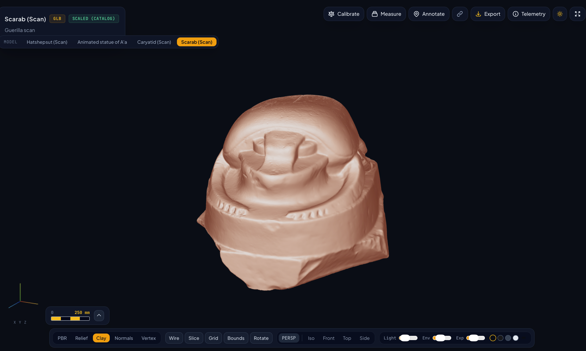

# @micropasts/glb-model-viewer


[](http://orcid.org/0000-0002-0246-2335)

[](https://doi.org/10.6084/m9.figshare.35125159)

A lightweight, high-precision Three.js GLB/glTF 3D artifact and model viewer for React. Built for cultural heritage, numismatics, archaeology, and scientific inspection, featuring 3-tier physical scale calibration, a collapsible zebra photoscale bar with universal reference object silhouettes, portable 3D spatial annotations with guided tours, point-to-point surface measurements, glTF animation playback, cross-section slicing, raking studio lighting, and multi-format mesh exports.

The models in the demo include the *Head and Shoulders of a Sphinx of Hatshepsut*, a 3D scan made on holiday in New York ([Met Museum collection record](https://www.metmuseum.org/art/collection/search/549029)), an animated model of *A'a* scanned by Thomas Flynn at the British Museum, a scan of a giant Scarab (now in the British Museum) and a scan of the *Caryatid* from the Acropolis of Athens (now in the British Museum). The scans by the author are licensed as CC-BY, the A'a is CC-BY-NC-SA.

## Screenshot of the demo



## Features

- **3-Tier Scale Calibration**:
  - **Catalog Auto-Scale**: Pass `knownMaxDimensionMm` from your database record to normalize the bounding box's longest axis automatically.
  - **Metric Sanity Check**: Converts standard glTF meter units to millimeters (`defaultUnitScale={1000}`) while automatically flagging implausible dimensions as unscaled.
  - **Interactive 2-Point Calibration**: Click any two reference points on a scale bar or known feature and enter the real-world millimeter distance to calibrate unscaled photogrammetry meshes on the fly.
- **Portable 3D Spatial Annotations & Guided Tour**:
  - **Backend-Agnostic Schema & W3C / IIIF 3D Support**: Accepts either native portable annotation JSON or standard W3C Web Annotation / IIIF 3D `PointSelector` payloads, with built-in bidirectional adapters (`toW3CWebAnnotations`, `encodeAnnotationsHash`, `decodeAnnotationsHash`).
  - **Controlled or Uncontrolled Modes**: Works zero-backend with `defaultAnnotations` or integrates with REST/GraphQL/Laravel APIs via `annotations` and `onCreateAnnotation` / `onUpdateAnnotation` / `onDeleteAnnotation` callbacks.
  - **Surface Normal Occlusion & Camera Fly-To**: Automatically fades pins facing away from the camera, smoothly tweens to saved curatorial camera viewpoints, and provides a `< 1 / N >` guided tour stepper bar.
- **Zebra Photoscale & Reference Object Silhouettes**: A high-contrast 4-segment archaeological scale bar that automatically adapts to zoom level and metric/imperial units (`mm`, `cm`, `in`), paired with a collapsible comparison drawer featuring true-to-scale silhouettes (**AA Cell**, **Tennis Ball**, **330ml Can**, and **A4 Sheet**).
- **Point-to-Point Surface Measurements**: BVH-accelerated (`three-mesh-bvh`) 3D surface raycasting for instant point placement even on dense, multi-million-triangle scans, complete with projected 2D distance badges (`mm`, `cm`, and `in`).
- **glTF Keyframe Animation Timeline**: Automatically mounts a responsive playback bar whenever a `.glb`/`.gltf` contains embedded animations, supporting play/pause, clip selection, timeline scrubbing, and playback speed cycling (`0.5×`, `1×`, `2×`).
- **Diagnostic Shading & Studio IBL Lighting**: Switch between **PBR** (lit by Three.js `RoomEnvironment` Image-Based Lighting with adjustable **Env** intensity, **Exposure**, and raking **Light** angle), **Relief** (screen-space normal curvature shader for faint inscriptions and tool marks), **Clay** (Matcap raking relief), **Normals**, and **Vertex Colors**, plus **Wireframe** overlay.
- **Draco & KTX2 Compression Support**: Built-in `DRACOLoader` and `KTX2Loader` configuration with sensible CDN defaults and customizable decoder paths.
- **Cross-Section Slicer**: Interactive X, Y, and Z clipping planes (`0%–100%`) with a translucent slice plane indicator.
- **Scoped Light & Dark UI Themes**: Toggle between frosted Light and Dark HUD themes independently of the host page (`initialTheme="dark"` or `"light"`), with all CSS scoped under `.gmv-root`.
- **Metadata & Paradata Record**: Optionally present object metadata, capture and processing details, texture provenance, and derived assets in an accessible viewer dialog.
- **Modular & Composable**: Toggle individual toolbars, panels, and features on or off via boolean props, or import standalone HUD sub-components (`ScaleBarOverlay`, `AnnotationOverlay`, `AnimationTimeline`, `TelemetryDrawer`, etc.) directly.
- **Multi-Format Exports**: Download the original `.glb`, convert in-browser to `.obj` or binary 3D-print-ready `.stl`, capture `.png` viewport renders, or record a 5-second 360° turntable `.webm` clip.
- **Accessible & Memory-Safe**: Full keyboard navigation (orbit, pan, zoom, and tool shortcuts), ARIA roles/live regions, and strict WebGL geometry, texture, BVH, and context disposal on unmount.

---

## Installation

Install the package alongside its peer dependencies (`react`, `react-dom`, and `three` `>=0.163.0`):

```bash
npm install @micropasts/glb-model-viewer three
```

The bundled styles use Tailwind CSS 4 and require Safari 16.4+, Chrome 111+, or Firefox 128+.

---

## Usage in Your App

### 1. Basic React / Vite Setup

Import both `ModelViewer` and its bundled stylesheet (`@micropasts/glb-model-viewer/style.css`). Wrap the component in a container with an explicit width and height:

```jsx
import React from 'react';
import { ModelViewer } from '@micropasts/glb-model-viewer';
import '@micropasts/glb-model-viewer/style.css';

export default function ArtifactPage() {
    return (
        <div style={{ width: '100%', height: '650px' }}>
            <ModelViewer
                modelUrl="/models/hatshepsut.glb"
                title="Head and Shoulders of a Sphinx of Hatshepsut"
                subtitle="Indurated Limestone • New Kingdom, Dynasty 18 (ca. 1479–1458 B.C.)"
                badge="GLB"
                fileName="hatshepsut_sphinx.glb"
                fileSize="8.4 MB"
                knownMaxDimensionMm={520}
                initialTheme="dark"
                onLoad={(stats) => {
                    console.log('Loaded mesh stats:', stats);
                }}
                onCalibrate={({ scaleFactor, targetMm }) => {
                    console.log(`Calibrated to ${targetMm} mm (factor: ${scaleFactor})`);
                }}
            />
        </div>
    );
}
```

> [!IMPORTANT]
> `ModelViewer` fills `100%` of its parent container (`width: 100%; height: 100%`). Always give the wrapping `<div>` an explicit height (such as `height: 100vh`, `height: 600px`, or Tailwind's `h-[80vh]`), otherwise the WebGL canvas will collapse to `0px`.

---

### 2. Customizing Visible Tools & Presets

Every UI panel and interactive tool can be toggled independently via boolean props (all default to `true`, except annotation mutation flags). For example, to render a clean, minimal embed card for a catalog grid:

```jsx
<div className="w-full h-[420px]">
    <ModelViewer
        modelUrl="/models/hatshepsut.glb"
        title="Sphinx of Hatshepsut"
        knownMaxDimensionMm={520}
        initialTheme="light"
        showBottomToolbar={false}
        showReferenceObjects={false}
        showTelemetry={false}
        enableCalibrate={false}
        enableMeasure={false}
        enableExport={false}
        enableDeepLink={false}
    />
</div>
```

You can also pass custom JSX overlays as `children` inside `<ModelViewer>`—they will render inside the `.gmv-root` container above the WebGL canvas.

---

### 3. Next.js (App Router) Setup

Because Three.js accesses `window` and WebGL APIs, load the component inside a Client Component (`'use client'`) or via `next/dynamic` with `ssr: false`:

```jsx
'use client';

import dynamic from 'next/dynamic';
import '@micropasts/glb-model-viewer/style.css';

const ModelViewer = dynamic(
    () => import('@micropasts/glb-model-viewer').then((mod) => mod.ModelViewer),
    { ssr: false }
);

export default function NextArtifactViewer({ modelUrl, title }) {
    return (
        <div className="w-full h-[80vh]">
            <ModelViewer modelUrl={modelUrl} title={title} />
        </div>
    );
}
```

---

### 4. Laravel + Blade Setup

Mount the viewer onto a DOM element carrying `data-*` attributes from your Eloquent model:

**`resources/js/threeD-viewer.jsx`**

```jsx
import React from 'react';
import { createRoot } from 'react-dom/client';
import { ModelViewer } from '@micropasts/glb-model-viewer';
import '@micropasts/glb-model-viewer/style.css';

const rootEl = document.getElementById('model-viewer-root');

if (rootEl) {
    const maxMm = rootEl.dataset.maxMm ? parseFloat(rootEl.dataset.maxMm) : null;

    createRoot(rootEl).render(
        <ModelViewer
            modelUrl={rootEl.dataset.modelUrl}
            title={rootEl.dataset.title}
            subtitle={rootEl.dataset.subtitle}
            fileName={rootEl.dataset.fileName}
            knownMaxDimensionMm={maxMm}
        />
    );
}
```

**`resources/views/finds/viewer.blade.php`**

```blade
<div class="w-full h-[calc(100vh-4rem)]">
    <div
        id="model-viewer-root"
        data-model-url="{{ $modelUrl }}"
        data-title="{{ $find->find_identifier }}"
        data-subtitle="{{ $find->objectTerm?->term }} • {{ $find->broadPeriod?->term }}"
        data-file-name="{{ $find->find_identifier }}.glb"
        data-max-mm="{{ $find->length ?? '' }}"
        class="w-full h-full"
    ></div>
</div>

@viteReactRefresh
@vite(['resources/js/threeD-viewer.jsx'])
```

---

## Spatial Annotations Module

`ModelViewer` includes a backend-agnostic spatial annotations layer designed to store and exchange 3D surface pins across static JSON sidecars, relational databases (Laravel/PostgreSQL/MariaDB), W3C Web Annotation / IIIF 3D manifests, or URL hashes.

### Annotation Data Schema

Each annotation stores its 3D anchor in **model-local coordinates** (`target.position`), the **surface normal** (`target.normal`) for automatic back-face occlusion fading, an optional **camera viewpoint** (`camera`) for guided tour fly-to transitions, and curatorial metadata (`body`):

```json
{
  "id": "ann-01hxyz89",
  "target": {
    "position": [0.0142, 0.1185, 0.0431],
    "normal": [0.12, 0.34, 0.93],
    "meshName": "hatshepsut_head_mesh"
  },
  "camera": {
    "position": [0.045, 0.16, 0.22],
    "target": [0.0142, 0.1185, 0.0431],
    "projection": "perspective"
  },
  "body": {
    "title": "Uraeus Cobra Fragment",
    "summary": "Broken hood of the royal uraeus on the brow of the nemes headdress.",
    "category": "damage",
    "tags": ["iconography", "conservation"],
    "author": "D. Pett",
    "createdAt": "2026-11-17T15:30:00Z"
  }
}
```

Supported built-in `body.category` values are `'note'`, `'damage'` (Condition), `'iconography'`, `'inscription'`, and `'manufacture'` (Technique).

### Mode A: Zero-Backend / Static JSON Sidecar (Uncontrolled)

Pass `defaultAnnotations` (fetched from a static `.json` file or bundled directly) and enable creation/editing in memory:

```jsx
<ModelViewer
    modelUrl="/models/hatshepsut.glb"
    defaultAnnotations={sidecarAnnotations}
    enableAnnotationCreate={true}
    enableAnnotationEdit={true}
    enableAnnotationDelete={true}
/>
```

### Mode B: Database / REST API Integration (Controlled)

Pass `annotations` from your API state and wire `onCreateAnnotation`, `onUpdateAnnotation`, and `onDeleteAnnotation` to persist changes to your backend:

```jsx
function CuratorialViewer({ findId, modelUrl }) {
    const [annotations, setAnnotations] = useState([]);
    const [selectedId, setSelectedId] = useState(null);

    useEffect(() => {
        fetch(`/api/finds/${findId}/annotations`)
            .then((res) => res.json())
            .then(setAnnotations);
    }, [findId]);

    return (
        <ModelViewer
            modelUrl={modelUrl}
            annotations={annotations}
            selectedAnnotationId={selectedId}
            enableAnnotationCreate={true}
            enableAnnotationEdit={true}
            enableAnnotationDelete={true}
            onSelectAnnotation={(ann) => setSelectedId(ann?.id ?? null)}
            onCreateAnnotation={async (draft) => {
                const res = await fetch(`/api/finds/${findId}/annotations`, {
                    method: 'POST',
                    headers: { 'Content-Type': 'application/json' },
                    body: JSON.stringify(draft),
                });
                const saved = await res.json();
                setAnnotations((prev) => [...prev, saved]);
                return saved;
            }}
            onUpdateAnnotation={async (updated) => {
                const res = await fetch(`/api/annotations/${updated.id}`, {
                    method: 'PATCH',
                    headers: { 'Content-Type': 'application/json' },
                    body: JSON.stringify(updated),
                });
                const saved = await res.json();
                setAnnotations((prev) => prev.map((a) => (a.id === saved.id ? saved : a)));
                return saved;
            }}
            onDeleteAnnotation={async (id) => {
                await fetch(`/api/annotations/${id}`, { method: 'DELETE' });
                setAnnotations((prev) => prev.filter((a) => a.id !== id));
            }}
        />
    );
}
```

### Mode C: W3C Web Annotation / IIIF 3D & URL Hash Portability

You can pass standard **W3C Web Annotation / IIIF 3D `PointSelector`** objects directly into `annotations` or `defaultAnnotations`—the viewer normalizes them automatically. You can also export or serialize annotations using the built-in helpers:

```javascript
import {
    toW3CWebAnnotations,
    encodeAnnotationsHash,
    decodeAnnotationsHash,
} from '@micropasts/glb-model-viewer';

// Export current annotations as W3C Web Annotation / IIIF 3D JSON-LD
const jsonLd = toW3CWebAnnotations(annotations, 'https://example.org/models/hatshepsut.glb');

// Serialize annotations into a shareable URL hash (#annotations=...)
const hash = encodeAnnotationsHash(annotations);
window.history.replaceState(null, '', `#annotations=${hash}`);
```

For a controlled viewer, restore the hash into the host's state on load:

```jsx
import { useEffect, useState } from 'react';
import { ModelViewer, decodeAnnotationsHash } from '@micropasts/glb-model-viewer';

function SharedAnnotationsViewer({ modelUrl }) {
    const [annotations, setAnnotations] = useState([]);
    const [hashError, setHashError] = useState(false);

    useEffect(() => {
        const hash = window.location.hash;
        if (!hash.includes('annotations=')) return;
        const restored = decodeAnnotationsHash(hash);
        if (restored === null) {
            setHashError(true);
            return;
        }
        setAnnotations(restored);
    }, []);

    return (
        <div style={{ width: '100%', height: 650 }}>
            {hashError && <p role="alert">Could not restore annotations from the link.</p>}
            <ModelViewer modelUrl={modelUrl} annotations={annotations} />
        </div>
    );
}
```

In uncontrolled mode, `ModelViewer` already initializes from a nonempty annotation hash when `enableDeepLink` is true; a controlled `annotations` prop takes precedence. The compact hash is not a lossless backup: it omits tags, author, creation date, style, mesh name, and camera projection, and rounds coordinates. Use your sidecar or database for complete records. `decodeAnnotationsHash` returns `null` for a missing or invalid payload, and the decoder accepts at most 32,768 base64 characters. The URL hash can be copied or shared, so do not include confidential annotation data.

---

## Handling Unscaled Photogrammetry Models

3D scans exported from photogrammetry tools (such as Agisoft Metashape or RealityCapture) without a scale bar often use arbitrary mesh units rather than meters. `ModelViewer` handles this automatically:

1. **Database-Driven Calibration (`knownMaxDimensionMm`)**: If your catalog record already stores the object's longest physical measurement in millimeters, pass it via `knownMaxDimensionMm`. The viewer normalizes the bounding box so every point-to-point measurement and the zebra photoscale bar are accurate immediately.
2. **Metric Unit Scaling (`defaultUnitScale`)**: If `knownMaxDimensionMm` is omitted, the viewer multiplies raw mesh units by `defaultUnitScale` (`1000` by default, converting standard glTF meters to millimeters) and checks whether the result falls within `sanityRangeMm` (`[0.5, 5000]` mm).
3. **Interactive 2-Point Calibration**: If a model falls outside `sanityRangeMm` (or `defaultUnitScale={null}` is passed), the header displays an **Unscaled • Calibrate** badge. Clicking it (or pressing `C`) lets the user click two points of known distance on the mesh and enter the real millimeter length to calibrate the session.

---

## Props Reference

### TypeScript

The package ships declaration files and exports types from its main entry point:

```tsx
import { ModelViewer } from '@micropasts/glb-model-viewer';
import type {
    ModelViewerProps,
    Annotation,
    MeshStats,
    CalibrationResult,
} from '@micropasts/glb-model-viewer';
import '@micropasts/glb-model-viewer/style.css';

const handleLoad = (stats: MeshStats) => console.log(stats.triangles);
const handleCalibrate = (result: CalibrationResult) => console.log(result.scaleFactor);
const handleSelect = (annotation: Annotation | null) => console.log(annotation?.body.title);

const viewerProps: ModelViewerProps = {
    modelUrl: '/models/artifact.glb',
    onLoad: handleLoad,
    onCalibrate: handleCalibrate,
    onSelectAnnotation: handleSelect,
};

export function TypedViewer() {
    return <div style={{ width: '100%', height: 650 }}><ModelViewer {...viewerProps} /></div>;
}
```

`Annotation` describes a normalized annotation returned to callbacks. For incoming native or W3C inputs, see the exported `AnnotationInput` and related types.

### Core & Asset Props

| Prop | Type | Default | Description |
| --- | --- | --- | --- |
| `modelUrl` | `string` | **Required** | URL or path to the `.glb` or `.gltf` asset (must support CORS if hosted cross-origin). |
| `title` | `string` | `'3D Model'` | Primary heading displayed in the top-left header. |
| `subtitle` | `string` | `''` | Secondary metadata line (period, material, classification). |
| `badge` | `string` | `'GLB'` | Uppercase format badge next to the title. |
| `fileName` | `string` | `'model'` | Base filename used when exporting `.glb`, `.obj`, `.stl`, `.png`, or `.webm`. |
| `fileSize` | `string \| null` | `null` | Optional human-readable file size displayed in the Telemetry drawer. |
| `backUrl` | `string \| null` | `null` | Optional URL rendering a back navigation button in the top-left header. |
| `knownMaxDimensionMm` | `number \| null` | `null` | Known longest physical dimension (in mm) to auto-calibrate the mesh. |
| `defaultUnitScale` | `number \| null` | `1000` | Multiplier converting raw mesh units to mm (`1000` for meters, `10` for cm, `null` for unscaled). |
| `sanityRangeMm` | `[number, number]` | `[0.5, 5000]` | Plausible millimeter range before flagging `defaultUnitScale` output as unscaled. |
| `initialBackground` | `string` | `'#090d16'` | Initial hex background color of the WebGL viewport. |
| `initialTheme` | `'light' \| 'dark'` | `'dark'` | Initial UI theme for the frosted-glass HUD panels. |
| `dracoDecoderPath` | `string` | gstatic CDN `1.5.7` | Base path/URL to Draco WASM/JS decoder files for compressed meshes. |
| `ktx2TranscoderPath` | `string` | gstatic CDN `2021-04-15` | Base path/URL to Basis Universal KTX2 transcoder files. |
| `paradata` | `Paradata \| null` | `null` | Optional metadata and paradata record; enables the Paradata button when `showParadata` is true. |

### Optional UI & Tool Toggles

| Prop | Type | Default | Description |
| --- | --- | --- | --- |
| `showHeader` | `boolean` | `true` | Shows or hides the top-left title, badge, and scale status card. |
| `showBottomToolbar` | `boolean` | `true` | Shows or hides the bottom shading, overlay, camera, and lighting toolbar. |
| `showScaleBar` | `boolean` | `true` | Shows or hides the dynamic zebra photoscale bar (when model is scaled). |
| `showReferenceObjects` | `boolean` | `true` | Enables the expandable reference object silhouettes (AA Cell, Tennis Ball, 330ml Can, A4 Sheet) on the scale bar. |
| `showAnimationTimeline` | `boolean` | `true` | Shows the timeline scrubber bar when the loaded glTF/GLB contains animations. |
| `showThemeToggle` | `boolean` | `true` | Shows the Light/Dark UI theme toggle button in the top-right toolbar. |
| `showTelemetry` | `boolean` | `true` | Shows the Telemetry button and mesh statistics/measurements drawer. |
| `showParadata` | `boolean` | `true` | Allows the Paradata button and dialog when a `paradata` object is supplied. |
| `enableMeasure` | `boolean` | `true` | Enables the point-to-point measurement tool (`M` shortcut). |
| `enableCalibrate` | `boolean` | `true` | Enables the 2-point manual scale calibration tool (`C` shortcut). |
| `enableExport` | `boolean` | `true` | Shows the Export dropdown menu (`.glb`, `.obj`, `.stl`, `.png`, `.webm`). |
| `enableFullscreen` | `boolean` | `true` | Shows the fullscreen toggle button. |
| `enableDeepLink` | `boolean` | `true` | Enables `#view=...` and `#annotations=...` URL hash serialization and restoration. |

Keyboard shortcuts work when the 3D viewport has focus. In perspective projection, the scale bar and reference objects represent scale at the orbit target's depth; objects closer to or farther from the camera have a different apparent scale.

### Spatial Annotations Props

| Prop | Type | Default | Description |
| --- | --- | --- | --- |
| `annotations` | `Annotation[]` | `undefined` | Controlled list of annotations (supports native schema or W3C Web Annotation / IIIF 3D objects). |
| `defaultAnnotations` | `Annotation[]` | `[]` | Initial list of annotations when running in uncontrolled mode. |
| `selectedAnnotationId` | `string \| null` | `undefined` | Controlled ID of the currently active annotation pin. |
| `showAnnotations` | `boolean` | `true` | Shows or hides spatial annotation pins and detail popovers. |
| `showAnnotationTour` | `boolean` | `true` | Shows or hides the bottom `< 1 / N >` guided tour navigation bar when annotations exist. |
| `enableAnnotationCreate` | `boolean` | `false` | Enables the **Annotate** toolbar button so users can click the mesh surface to drop new pins. |
| `enableAnnotationEdit` | `boolean` | `false` | Shows an **Edit** button inside annotation popovers. |
| `enableAnnotationDelete` | `boolean` | `false` | Shows a **Delete** button inside annotation popovers. |
| `onSelectAnnotation` | `(ann: Annotation \| null) => void` | `null` | Callback fired when a pin is clicked, stepped through in the tour, or closed. |
| `onCreateAnnotation` | `(draft: Annotation) => Promise<Annotation> \| Annotation` | `null` | Async or sync callback fired when a new surface pin is saved. |
| `onUpdateAnnotation` | `(updated: Annotation) => Promise<Annotation> \| Annotation` | `null` | Async or sync callback fired when an existing annotation is edited. |
| `onDeleteAnnotation` | `(id: string) => Promise<void> \| void` | `null` | Async or sync callback fired when an annotation is deleted. |
| `renderAnnotationBody` | `(ann: Annotation) => React.ReactNode` | `null` | Optional custom renderer for rich HTML, Markdown, or linked citations inside the annotation card. |

When `annotations` is controlled, provide the corresponding create, update, and delete callbacks for enabled editing actions and update the controlled list in the host application. Callbacks can reject to show a retryable error. An update callback that returns an annotation must retain its original ID.

### Metadata and Paradata

Pass a JavaScript object parsed from JSON or returned by an API. The viewer does not fetch it automatically. All sections are optional; omitted sections are hidden. The button appears only when a record is supplied and `showParadata` is true. Opening the dialog moves focus into it; Close, Escape, or the backdrop closes it.

```jsx
const paradata = {
    recordId: 'OBJECT-001',
    objectMetadata: [{ label: 'Material', value: 'Stone' }],
    processingSummary: {
        fields: [{ label: 'Software', value: 'Metashape' }],
        ratings: [{ label: 'Complexity', value: 'Medium' }],
    },
    textureMaps: [{ name: 'Albedo', statuses: ['MEASURED'], notes: 'Unmodified' }],
    labNotes: 'Captured using a turntable.',
    derivedAssets: {
        assets: [{ asset: 'Model', filename: 'model.glb', downloadUrl: '/models/model.glb' }],
    },
};

<ModelViewer modelUrl="/models/model.glb" paradata={paradata} />
```

`title` overrides the heading; otherwise `recordId` is appended to the default heading. `objectMetadata`, `assessment`, and `captureTolerances` are arrays of `{ label, value }` with string, number, or boolean values. `processingSummary` contains optional `fields` and `ratings` arrays of the same shape. `textureMaps` contains `{ name, statuses?, notes? }`; built-in status colors recognize `MEASURED`, `ESTIMATED`, `PATCHED`, `SYNTHETIC`, and `NOT CREATED`, with a neutral style for other values. `labNotes` is a string.

`acquisitionChunks` contains rows with `chunk`, `exposure`, `opticsAndFocus`, `rotationalSteps`, and `images`. `derivedAssets` accepts `software` and `assets` rows with `asset`, `mesh`, `alignment`, `tiePoints`, `vertices`, `faces`, `filename`, `format`, `size`, and optional `downloadUrl`. `extraSections` accepts `{ title, fields?, notes? }`. Missing optional table cells display a dash. For TypeScript, import `Paradata` and the related `ParadataField`, `ParadataTextureMap`, `ParadataAcquisitionChunk`, and `ParadataDerivedAsset` types.

Treat `downloadUrl` values as trusted links or validate them in your application before passing a record. When switching models, supply the matching record or `null`; the drawer closes when `modelUrl` changes. The demo loads the example file for the Scarab selection only.

The demo fetches [`scarab.json`](./demo/public/data/scarab.json) as JSON and passes the parsed object to `ModelViewer`. It describes British Museum object [EA74](https://www.britishmuseum.org/collection/object/Y_EA74); the supplied scan details identify Daniel Pett as the creator, a Nikon D500 as the camera, and RealityCapture as the processing software. Its CHAN-style sections include details inspected from the bundled demo GLB and explicitly mark unavailable acquisition and processing details; the acquisition table's placeholder is not a recorded chunk. The separate [`chan009.json`](./demo/public/data/chan009.json) preserves the original example record and is not associated with the Scarab model. JSON files must be served by the application or another CORS-enabled server.

### Callbacks & Children

| Prop | Type | Default | Description |
| --- | --- | --- | --- |
| `onLoad` | `(stats: MeshStats) => void` | `null` | Callback fired once the model parses and renders (`{ triangles, vertices, meshes, rawSize }`). |
| `onError` | `(error: unknown) => void` | `null` | Callback fired if fetching or parsing the 3D asset fails. |
| `onCalibrate` | `(result: CalibrationResult) => void` | `null` | Callback fired when a user applies a manual 2-point calibration (`{ scaleFactor, targetMm }`). |
| `children` | `React.ReactNode` | `null` | Optional custom HUD elements rendered inside the `.gmv-root` viewport container. |

---

## Exported Sub-Components & Helpers

In addition to `ModelViewer`, the package exports its individual HUD building blocks, distance formatter, and annotation serialization adapters:

```javascript
import {
    ModelViewer,
    TopBar,
    BottomToolbar,
    TelemetryDrawer,
    ParadataDrawer,
    ScaleBarOverlay,
    AnimationTimeline,
    AnnotationOverlay,
    ThemeToggle,
    formatDistance,
    normalizeAnnotation,
    normalizeAnnotationList,
    toW3CWebAnnotations,
    encodeAnnotationsHash,
    decodeAnnotationsHash,
} from '@micropasts/glb-model-viewer';
```

The HUD components are presentation components: when used separately, the host must supply their state, event handlers, and any camera, measurement, projection, or persistence logic. They do not automatically connect to a `ModelViewer` instance. Import the bundled stylesheet and render them inside an element with the `gmv-root` class so their scoped styles apply. Add `dark` to that element for the dark theme. Position absolute overlays inside a relatively positioned container of the appropriate size.

For example:

```jsx
import { ScaleBarOverlay } from '@micropasts/glb-model-viewer';
import '@micropasts/glb-model-viewer/style.css';

function ScaleExample() {
    // Replace this with the calibrated scale at the displayed camera depth.
    const pixelsPerMm = 1.2;
    return (
        <div className="gmv-root dark">
            <ScaleBarOverlay pixelsPerMm={pixelsPerMm} isUnscaled={false} measureUnit="cm" />
        </div>
    );
}
```

In the references below, **required** means the host must provide the prop for the standalone component; `setX` props marked as React setters must accept either a value or a function of the previous value. TypeScript users can import the exported `*Props` interfaces for all of these components except `ThemeToggle`, whose props are declared inline.

### `ScaleBarOverlay`

Displays a physical scale and, optionally, expandable reference silhouettes. It renders nothing for an unscaled model or a non-positive/non-finite `pixelsPerMm`. The host must calculate and update `pixelsPerMm` as the view changes; in perspective projection it depends on depth.

| Prop | Type | Default | Description |
| --- | --- | --- | --- |
| `pixelsPerMm` | `number` | **Required** | Screen pixels per physical millimeter at the relevant depth. |
| `isUnscaled` | `boolean` | **Required** | Suppresses the overlay when physical scale is unknown. |
| `measureUnit` | `'mm' \| 'cm' \| 'in'` | `'mm'` | Preferred display unit. Large metric values may be shown in meters; inches may be shown in feet. |
| `allowReferenceToggle` | `boolean` | `true` | Allows the user to expand the reference-object comparison. |

### `AnnotationOverlay`

Displays projected pins, a detail/editor card, and a tour bar. Supply normalized native `Annotation` objects (e.g. via `normalizeAnnotationList`), not raw W3C objects. The host projects 3D points into container-local pixel coordinates and owns selection and persistence; pins are associated with annotations by ID.

| Prop | Type | Default | Description |
| --- | --- | --- | --- |
| `annotations` | `Annotation[]` | `[]` | Normalized annotations with unique IDs. |
| `projectedPins` | `ProjectedPin[]` | `[]` | Each pin has `id`, `screenX`, `screenY`, `visible`, and `occluded`; coordinates are pixels relative to the overlay's top-left. |
| `selectedId` | `string \| null` | `null` | ID of the selected annotation. |
| `onSelect` | `(annotation: Annotation \| null) => void` | `undefined` | Selects or closes an annotation; update `selectedId` in the host. |
| `draftAnchor` | `{ target: AnnotationTarget, camera: AnnotationCamera \| null } \| null` | `null` | Position/normal and optional camera for a new annotation form. |
| `canCreate`, `canEdit`, `canDelete` | `boolean` | `false` | Enable the respective creation, editing, and deletion UI. |
| `onCancelDraft` | `() => void` | `undefined` | Cancel creation; clear `draftAnchor` in the host. |
| `onSaveDraft` | `(draft: AnnotationDraft) => void \| Promise<void>` | `undefined` | Save a new draft and update the host's annotations and draft state. Required to save when creation is enabled. |
| `onUpdate` | `(annotation: Annotation) => void \| Promise<void>` | `undefined` | Persist and update an edited annotation. Required to save edits. |
| `onDelete` | `(id: string) => void \| Promise<void>` | `undefined` | Persist removal and update the host's annotations/selection. Required to delete. |
| `renderAnnotationBody` | `(annotation: Annotation) => React.ReactNode` | `null` | Override the default detail body. |
| `showTourBar` | `boolean` | `true` | Show tour navigation when annotations exist. |

Mutation callbacks can reject to show a retryable error. A draft contains `target`, `camera`, and `body`, but not an ID or style: the host is responsible for creating a full annotation. The exported `Annotation`, `AnnotationDraft`, `AnnotationTarget`, `AnnotationCamera`, and `ProjectedPin` types describe these shapes.

For a full viewer, `renderAnnotationBody` is often simpler than building a standalone overlay. For example, render a link to a trusted collection search:

```jsx
<ModelViewer
    modelUrl="/models/artifact.glb"
    defaultAnnotations={sidecarAnnotations}
    renderAnnotationBody={(annotation) => (
        <div>
            <p>{annotation.body.summary}</p>
            <a
                href={`https://collection.example/search?q=${encodeURIComponent(annotation.body.title)}`}
                target="_blank"
                rel="noopener noreferrer"
            >
                Search collection records
            </a>
        </div>
    )}
/>
```

Replace the example URL with your own trusted collection service. If links come from external annotation data, validate their URL scheme and destination before rendering them. The callback replaces the default body content, so include any summary or tags you still want displayed.

### `TelemetryDrawer`

| Prop | Type | Default | Description |
| --- | --- | --- | --- |
| `isOpen` | `boolean` | **Required** | When false, renders nothing. |
| `onClose` | `() => void` | **Required** | Close the drawer. |
| `formattedDims` | `string` | **Required** | Already formatted bounding-box dimensions. |
| `isUnscaled` | `boolean` | **Required** | Whether measurements lack a physical scale. |
| `scaleSource` | `string` | **Required** | Description of the calibration source. |
| `stats` | `MeshStats` | **Required** | Mesh statistics, including numeric `triangles`, `vertices`, and `meshes`, plus `rawSize: THREE.Vector3`. |
| `fileName`, `fileSize` | `string \| null` | `undefined` | Optional source filename and human-readable size. |
| `measurements` | `{ id: string, rawDistance: number }[]` | **Required** | Distances in mesh units. |
| `onClearMeasurements` | `() => void` | **Required** | Clear the recorded measurements in the host. |
| `formatDistanceFn` | `(distance: number, compact: boolean) => string` | **Required** | Format each raw measurement for display. |

The exported `formatDistance(distance, { isUnscaled, customScaleFactor, measureUnit, compact })` helper can be wrapped as `formatDistanceFn`; the scale factor converts mesh units to millimeters.

### `ParadataDrawer`

For standalone composition, render the named export in a positioned `.gmv-root` container. The host controls its visibility and supplies the record.

| Prop | Type | Default | Description |
| --- | --- | --- | --- |
| `isOpen` | `boolean` | **Required** | Whether the dialog is open. |
| `onClose` | `() => void` | **Required** | Close the dialog in the host. |
| `paradata` | `Paradata \| null` | **Required** | Record described above; `null` renders nothing. |

### `AnimationTimeline`

Renders nothing when `animations` is empty. The host owns the animation mixer and all playback state.

| Prop | Type | Default | Description |
| --- | --- | --- | --- |
| `animations` | `{ name: string }[]` | **Required** | Available clips; unnamed clips get a fallback label. |
| `activeClipIndex`, `onSelectClip` | `number`, `(index: number) => void` | **Required** | Selected clip and selection handler. |
| `isPlaying`, `onTogglePlay` | `boolean`, `() => void` | **Required** | Playback state and toggle handler. |
| `currentTime`, `duration`, `onScrub` | `number`, `number`, `(time: number) => void` | **Required** | Current time and duration in seconds; handle scrubbing. |
| `playbackSpeed`, `onChangeSpeed` | `number`, `(speed: number) => void` | **Required** | Playback rate and handler; the button cycles through `0.5`, `1`, and `2`. |

### `ThemeToggle`

| Prop | Type | Default | Description |
| --- | --- | --- | --- |
| `theme` | `'light' \| 'dark'` | **Required** | Current theme. |
| `onToggleTheme` | `() => void` | **Required** | Switch the host's theme and update the `dark` class on `.gmv-root`. |

### `BottomToolbar`

All props are required. The host applies the requested changes to its renderer and camera.

| Props | Type | Description |
| --- | --- | --- |
| `shadingMode`, `setShadingMode` | `'pbr' \| 'relief' \| 'sculpt' \| 'normals' \| 'vertex'`, React setter | Select the shading mode. |
| `wireframe`, `setWireframe`; `clipEnabled`, `setClipEnabled`; `showGrid`, `setShowGrid`; `showBBox`, `setShowBBox`; `autoRotate`, `setAutoRotate` | `boolean`, React setter for each pair | Toggle viewport overlays, clipping, and rotation. |
| `projectionMode`, `switchProjection` | `'perspective' \| 'orthographic'`, `(mode) => void` | Select camera projection. |
| `setCameraView` | `(view: 'iso' \| 'front' \| 'top' \| 'side') => void` | Apply a camera preset. |
| `lightAngle`, `setLightAngle` | `number`, React setter | Raking light angle in degrees (`0–360`). |
| `envIntensity`, `setEnvIntensity` | `number`, React setter | Environment reflection intensity (`0–2.5`). |
| `exposure`, `setExposure` | `number`, React setter | Tone-mapping exposure (`0.2–3`). |
| `bgColor`, `setBgColor` | `string`, React setter | Background color as a hex color string. |

### `TopBar`

This controlled toolbar accepts the following props. All state values and handlers are required unless a default is shown; feature flags hide controls but do not implement their behavior.

| Props | Type | Default | Description |
| --- | --- | --- | --- |
| `title`, `subtitle`, `badge`, `backUrl` | `string`; optional strings for the latter three | `undefined` for optional props | Header text, badge, and optional back-link URL. |
| `isUnscaled`, `scaleSource` | `boolean`, `string` | **Required** | Physical scale status and source label. |
| `calibrationMode`, `measureMode`, `annotationMode`, `inspectOpen` | `boolean` | **Required** | Active tool and telemetry state. |
| `paradata`, `paradataOpen`, `showParadata`, `onToggleParadata` | `Paradata \| null`, `boolean`, `boolean`, `() => void` | `null`, `false`, `true`, `undefined` | Record, dialog state, visibility flag, and handler for the optional Paradata button. Supply the handler when showing the button. |
| `showHeader`, `enableCalibrate`, `enableMeasure`, `enableDeepLink`, `enableExport`, `showTelemetry`, `showThemeToggle`, `enableFullscreen` | `boolean` | `true` | Show or enable the corresponding header/tool controls. |
| `enableAnnotationCreate` | `boolean` | `false` | Show the annotation-placement toggle. |
| `downloadMenuOpen`, `setDownloadMenuOpen` | `boolean`, React setter | **Required** | Controlled export-menu state. |
| `loading`, `error`, `exporting`, `recordingVideo` | `boolean`, `unknown`, `boolean`, `boolean` | **Required** | Status used to disable or label the export button. |
| `isFullscreen`, `theme` | `boolean`, `'light' \| 'dark'` | **Required** | Current fullscreen and UI theme state. |
| `onToggleTheme`, `onToggleCalibrate`, `onToggleMeasure`, `onToggleAnnotate`, `onToggleInspect`, `onToggleFullscreen` | `() => void` | **Required** | Handle the corresponding toggles. |
| `onCopyShareLink`, `onDownloadOriginal`, `onScreenshot`, `onRecordTurntable` | `() => void` | **Required** | Handle sharing and export actions. |
| `onExportMesh` | `(format: 'obj' \| 'stl') => void` | **Required** | Export the selected mesh format. |

---

## Troubleshooting

### Model fetch fails or the browser reports CORS errors

- Check the browser's **Network** and **Console** tabs for the failing request, status code, redirect, and URL. Pass `onError={(error) => console.error(error)}` to inspect model loading/parsing errors.
- Serve the app and model over HTTP(S), rather than opening the page directly as a `file://` URL. Confirm that `modelUrl` resolves from the deployed page and returns the model, not an HTML error page.
- If the model or any external `.gltf` buffers or textures are on another origin, configure that server (including redirect and error responses) to allow your app's origin with an appropriate `Access-Control-Allow-Origin` header. If credentials are involved, the server must use a specific allowed origin and permit credentials; a wildcard origin is not valid for credentialed requests. This package does not expose a loader credential or custom-header option.
- Check that an HTTPS page does not load HTTP assets, and that the site's Content Security Policy (CSP) allows the relevant requests.
- Cross-origin textures must be CORS-enabled for canvas readback. A blocked texture can prevent the model from loading, and a canvas tainted by cross-origin content can prevent PNG export or canvas capture for `.webm`. Check all texture requests, including resources used by custom integrations. Video capture also requires browser support for `captureStream`, `MediaRecorder`, and the `video/webm` recording format.

### Draco or KTX2 decoder/transcoder fails to load

The default paths are `https://www.gstatic.com/draco/versioned/decoders/1.5.7/` and `https://www.gstatic.com/basis-universal/versioned/2021-04-15-ba1c3e4/`. Models using Draco geometry or KTX2 textures may need these resources even when the model itself loads successfully. These defaults require network access; for offline use, self-host and make the model and decoder files available offline. Check Network and Console for failed JS/WASM requests, CORS errors, and CSP restrictions on scripts, workers, and WebAssembly.

To host them yourself, copy compatible decoder files from the same Three.js version used by your application into your web server's public directory. For example, with a Vite-style `public/` directory:

```sh
mkdir -p public/decoders/draco public/decoders/basis
cp node_modules/three/examples/jsm/libs/draco/draco_decoder.js node_modules/three/examples/jsm/libs/draco/draco_wasm_wrapper.js node_modules/three/examples/jsm/libs/draco/draco_decoder.wasm public/decoders/draco/
cp node_modules/three/examples/jsm/libs/basis/basis_transcoder.js node_modules/three/examples/jsm/libs/basis/basis_transcoder.wasm public/decoders/basis/
```

```jsx
<ModelViewer
    modelUrl="/models/artifact.glb"
    dracoDecoderPath="/decoders/draco/"
    ktx2TranscoderPath="/decoders/basis/"
    onError={(error) => console.error('Model load failed', error)}
/>
```

Paths are public **directory URLs**, including the trailing slash, not filesystem paths. For deployments under a URL prefix, include that prefix or use your bundler's base URL. Ensure every JS/WASM file returns successfully, WASM is served as `application/wasm`, cross-origin files have appropriate CORS headers, and CSP permits the decoder's workers and WebAssembly. Self-hosting also requires including these files in your deployment; they are not automatically copied by the viewer.

### Blank viewer, context loss, or poor performance

- Give the viewer's parent an explicit, nonzero height and width. Check the Console for WebGL initialization errors, and test browser hardware acceleration, graphics drivers, and WebGL support on the target device.
- Reduce mesh complexity or texture dimensions, use appropriate compressed assets, and test on the lowest-spec target device. BVH acceleration helps raycasting but does not remove GPU memory or draw-call limits. A device's texture-size and memory limits vary; there is no universal safe model size.
- Avoid mounting many viewers simultaneously: each instance creates a main WebGL renderer and may create a second renderer for the orientation gizmo. Unmount viewers that are no longer needed, and watch for browser messages about too many contexts or lost contexts.
- `onError` reports model loader errors; it is not a general WebGL initialization/context-loss handler. Inspect the browser Console for those failures.

---

## Keyboard Shortcuts & Mouse Controls

| Input | Action |
| --- | --- |
| `Double-click` (surface) | Smoothly focus and orbit around the clicked surface point |
| `Double-click` (background) | Reset camera to isometric fit view |
| `↑` `↓` `←` `→` | Orbit camera around target |
| `Shift` + `↑` `↓` `←` `→` | Pan camera |
| `+` / `-` | Zoom in / out |
| `M` | Toggle point-to-point measurement mode |
| `C` | Toggle 2-point scale calibration mode |
| `P` | Switch between Perspective and Orthographic projection |
| `G` | Toggle scale reference grid |
| `R` | Toggle turntable auto-rotation |
| `F` | Reset camera to isometric fit view |
| `Esc` | Cancel active measurement/calibration point or close menus |

---

## License

MIT © 2026 Daniel Pett